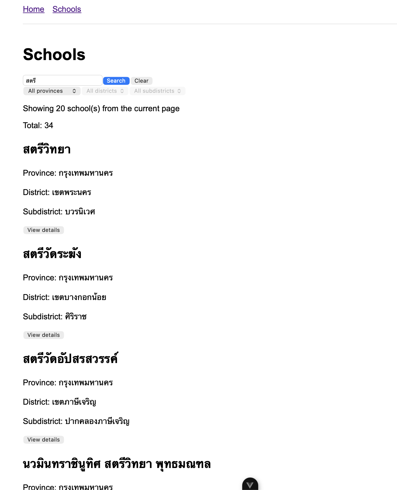
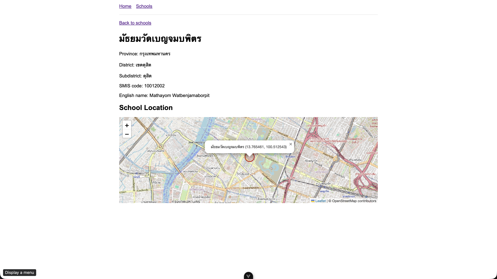

# Thai School Map

A web app for searching Thai schools and seeing where each one is on a map.

**Built with:** Vue 3, Vue Router, Leaflet, FastAPI, SQLite

Built for my Web Programming course at KMITL. The search and detail endpoints in the backend were provided by the course; I built the Vue frontend, the location endpoint and the map.



## Features
- Search 28,840 schools by keyword
- Filter by province → district → subdistrict
- Previous / Next paging through results
- School detail page with its location on an OpenStreetMap map
- Clear messages when a school or its location isn't found



## Running locally

The app needs the course's `school_directory.db`, which is not included in this repo. Put it in the project root (next to `backend/` and `frontend/`), or point `SCHOOLS_DB` at it.

**Backend** (Python 3.10+):

```bash
cd backend
python3 -m venv .venv
source .venv/bin/activate
pip install -r requirements.txt
uvicorn main:app --reload
```

**Frontend** (Node 22+), in a second terminal:

```bash
cd frontend
npm install
npm run dev
```

Open http://localhost:5173. The API runs on http://localhost:8000 (interactive docs at `/docs`).
